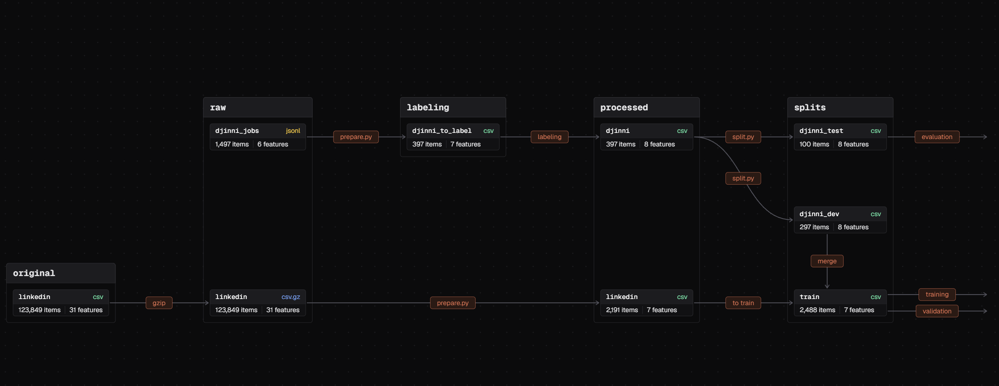

# Vacancy Role Classifier

Classifies a job posting by **role** (Data Analyst, Data Scientist, ML / AI Engineer, Python Backend, Other) and **level** (junior or not) from its title and description. The point of the project is the pipeline around the model: versioned data (DVC), tracked experiments and a model registry with a promotion rule (MLflow), a reproducibility check, a FastAPI service in Docker, tests, type checks and CI.

Stack: Python 3.13, scikit-learn, MLflow 3.17, DVC (S3 remote), FastAPI, Docker, pytest, mypy, GitHub Actions, `uv`.

## Result

| Task | Model in production | macro-F1 on the test set | Title keyword rule |
| --- | --- | --- | --- |
| Role | TF-IDF + Logistic Regression on the title | **0.882** | 0.890 |
| Level | TF-IDF + Logistic Regression on title and description | **0.695** | 0.728 |

The test set is `djinni_test`: 100 hand-labeled postings (6 Data Scientist, 12 junior), used once per final model. **A trained model is on the level of a simple keyword rule**, and the honest reading is in [docs/04_Insights.md](docs/04_Insights.md): fixing the labels (+0.14 macro-F1) mattered more than any model change.

Comparison on the Djinni dev set (5-fold cross-validation, data v0.2, runs in MLflow):

| Model | Role, macro-F1 | MLflow run |
| --- | --- | --- |
| Title keyword rule | 0.934 | `2a29056b` |
| TF-IDF, title | 0.913 | `305f027a` |
| TF-IDF, title + description | 0.920 | `2e4366ef` |
| TF-IDF, description | 0.762 | `50625b01` |
| Embeddings (multilingual-e5-small), title | 0.827 (0.885 with Djinni weight 25) | `575121d8` |

Prediction takes about 5 ms in the process and about 53 ms through the Docker service (p50 on one laptop).

## Data

- **LinkedIn Job Postings 2023-2024** (Kaggle, by arshkon, CC BY-SA 4.0): 123,220 usable postings; the role label is weak and comes from title keywords. After cleaning and downsampling "Other": 2,191 postings.
- **Djinni** (public `/jobs/` pages only): 1,497 collected, 397 labeled by Claude from the duties, with no human review. This is the evaluation set.
- Raw files are not committed or redistributed. DVC pointers (`data/*.dvc`) tie every model to the exact data version; `data_splits_md5` is logged in every MLflow run.
- Versions: `v0.1` (weak labels from title keywords) and `v0.2` (weak labels follow the labeling rules), see the tags.

Details, the labeling rules, the split and the evaluation protocol are in [docs/03_Data.md](docs/03_Data.md).

### Data flow



Folders are the groups, cards are the files, and every arrow is a step (`gzip`, `prepare.py`, `labeling`, `split.py`, `merge`). The arrows leaving `splits` show where each set is used: `training` and `validation` (cross-validation on the Djinni rows) use `train`, `evaluation` uses `djinni_test`.

## Quickstart: the service

Needs Docker. The service loads the `production` models from the MLflow registry.

```bash
docker compose up --build -d
```

```bash
curl -X POST http://localhost:8000/predict \
  -H "Content-Type: application/json" \
  -d '{"title": "Junior Data Analyst", "description": "SQL, Power BI, dashboards, up to 1 year of experience"}'
```

```json
{
  "role": {"label": "Data Analyst", "probability": 0.954, "probabilities": {"...": 0.0}},
  "level": {"label": "junior", "probability": 0.804, "probabilities": {"junior": 0.804, "not_junior": 0.196}}
}
```

Interactive docs: `http://localhost:8000/docs`. Health and model versions: `GET /health`. MLflow UI: `http://localhost:5000`.

## Reproduce the experiments

```bash
uv sync
cp .env.example .env        # AWS keys for the DVC remote and the MLflow address
docker compose up -d mlflow
uv run dvc pull             # needs access to the S3 remote
```

The data is not public, so `dvc pull` works only with access to the author's S3 remote. Without it, the LinkedIn dataset is on Kaggle and the Djinni postings would have to be collected again with `src/scrape` and labeled by hand.

Run the scripts as modules with `src` on the path (PowerShell: `$env:PYTHONPATH = "src"`, bash: `PYTHONPATH=src`):

```bash
uv run python -m models.run_baseline --target role           # keyword rule baseline
uv run python -m models.tf_idf title                         # TF-IDF, cross-validation on Djinni dev
uv run python -m models.embeddings title                     # sentence embeddings
uv run python -m models.error_analysis tfidf title           # confusion matrix, wrong predictions
uv run python -m models.final_eval title                     # train on all, score once on the test set
uv run python -m models.register <run_id>                    # register and promote by the quality gate
uv run python -m models.reproduce <run_id>                   # re-train and compare the metrics
```

`--target level` and `--djinni-weight W` work for the model scripts. A model gets the `production` alias when its test macro-F1 is at least the keyword rule's minus 0.04 (the noise of a 100-posting test set).

## Quality

```bash
uv run pytest --cov=src --cov-report=term-missing
uv run mypy
```

Unit tests cover the API, the rules, the data preparation and the model helpers; the training scripts that need MLflow, the data or the network are checked by the experiments and `reproduce` instead. CI runs `mypy` and `pytest` as two separate jobs on every pull request.

## Project layout

```text
src/api       FastAPI service (routes, prediction service, registry loader, schemas)
src/data      sources, preparation, split, constants
src/models    cross-validation, metrics, TF-IDF, embeddings, final evaluation, registry, reproducibility
src/rules     title keyword rules for the role and the level
src/scrape    Djinni scrapers
tests/        pytest
docs/         brief, work plan, data and labeling rules, insights
```

## Limitations

- The labels have **one annotator (Claude)** and no human review, so the test metrics measure agreement with one annotator, not with the truth.
- The test set is small (100 postings, 12 junior): per-class and level metrics are noisy. The level model passes the promotion gate only barely and is not better than the keyword rule.
- The keyword rule encodes the same labeling rules the labels were made with, so it is not an independent reference. The Djinni weight and the v0.2 label rules were chosen after looking at dev errors, so dev scores are optimistic; only the test set is an honest estimate.
- One source of postings per side (LinkedIn for training, Djinni for evaluation), no live data.
- Reproducibility was checked on one machine, not on a clean clone. Latency was measured once, on a laptop.
- Fine-tuning a transformer was skipped: the errors come from weak labels, not from model capacity.

## Documents

[Brief](docs/01_Project_Brief.md) · [Work plan](docs/02_Work_Plan.md) · [Data and labeling rules](docs/03_Data.md) · [Insights](docs/04_Insights.md)
